Hi, I'm **XxSeRyIxX**, an achievement hunter from Spain, on Steam since 2007. When
something I use is missing, I build it: tools for games, for my inbox and for Kodi.

## Things I made

<!-- projects:start -->
- **[IMMORTALITY-Clip-Tracker](<https://github.com/XxSeRyIxX/IMMORTALITY-Clip-Tracker>)**: Reads your IMMORTALITY save, or the clips you mark by hand on a console, and tells you exactly which clips you are still missing, and how to reach each one. In your browser or as an app for Windows, macOS and Linux. [Open it](<https://vseryi.github.io/IMMORTALITY-Clip-Tracker/>)
- **[mail-cleaner](<https://github.com/XxSeRyIxX/mail-cleaner>)**: Find the senders that flood your inbox, unsubscribe and delete everything they sent. Outlook and Gmail in your browser, plus IMAP in the desktop app for Windows, macOS and Linux. Your mail never passes through a server of ours.
- **[plugin.video.stremio2kodi](<https://github.com/XxSeRyIxX/plugin.video.stremio2kodi>)**: Stremio add-ons wrapper for Kodi.
- **[kodi](<https://github.com/XxSeRyIxX/kodi>)**: Kodi addon repository for VSeryi addons. [Open it](<https://vseryi.github.io/kodi/>)
<!-- projects:end -->

## Find me

[Website](https://xxseryixx.github.io/) · [Steam](https://steamcommunity.com/id/xxseryixx/)
